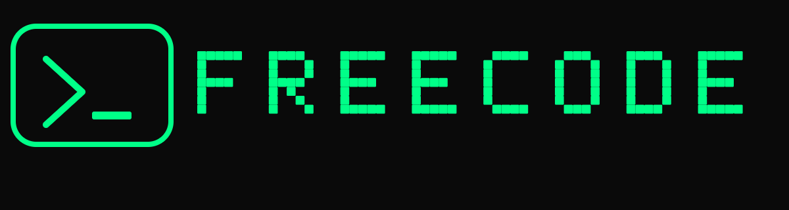
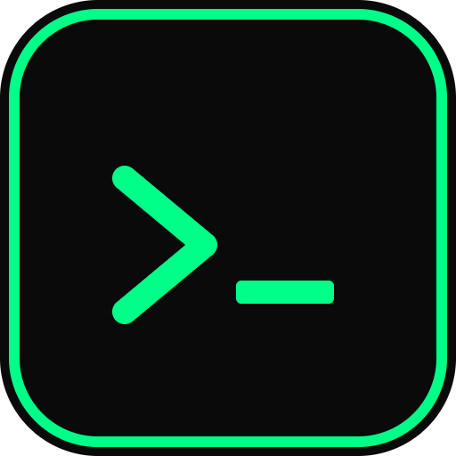

<div align="center">



**Sharp green terminal AI coding agent. Keyless free forever.**

`#00FF88` on `#0A0A0A` · 3 agents · editable system prompts · own-device pentest lab

[Quick start](#quick-start) · [Commands](#in-session-commands) · [Agents](#the-three-agents) · [KAI workflow](#kai--own-device-scan-workflow) · [Prompts](#editable-system-prompts) · [Gateway](#keyless-free-gateway) · [Desktop](#desktop-app) · [Safety](#safety-rules)

</div>

---

```
 ███████╗██████╗ ███████╗███████╗ ██████╗ ██████╗ ██████╗ ███████╗
 ██╔════╝██╔══██╗██╔════╝██╔════╝██╔════╝██╔═══██╗██╔══██╗██╔════╝
 █████╗  ██████╔╝█████╗  █████╗  ██║     ██║   ██║██║  ██║█████╗
 ██╔══╝  ██╔══██╗██╔══╝  ██╔══╝  ██║     ██║   ██║██║  ██║██╔══╝
 ██║     ██║  ██║███████╗███████╗╚██████╗╚██████╔╝██████╔╝███████╗
 ╚═╝     ╚═╝  ╚═╝╚══════╝╚══════╝ ╚═════╝ ╚═════╝ ╚═════╝ ╚══════╝
                       >_ freecode v1.0.0 - FreeCode Green
```

## What it is

FreeCode is a terminal coding agent you can actually install and use today:

- **Keyless and free.** No signup, no trial, no card. It talks to a free
  OpenAI-compatible gateway, falls back automatically, and can use your own key
  or a local model if you have one.
- **Three agents.** `ALEX` codes, `JIM` teaches defensive security, `KAI` runs a
  consent-gated pentest workflow on **your own** device.
- **Editable prompts, live.** Every agent's system prompt lives in
  `.freecode/system-prompts.json`. Edit the file and the running session reloads
  it instantly — no restart. The desktop app has a Settings → System Prompts
  page for the same thing.
- **Sharp green, no noise.** `#00FF88` on `#0A0A0A`, rounded panels, real
  streaming, ANSI-aware layout.
- **Zero npm dependencies.** Pure Node.js 18+. No install step, nothing to
  compile, works offline once cloned.

## Quick start

### Windows 11

```powershell
irm https://raw.githubusercontent.com/Patrineu22/Works/main/install.ps1 | iex
```

or from a clone:

```powershell
git clone https://github.com/Patrineu22/Works.git
cd Works
.\install.ps1
freecode
```

### macOS / Linux

```bash
git clone https://github.com/Patrineu22/Works.git
cd Works
./install.sh
freecode
```

### No install at all

```bash
git clone https://github.com/Patrineu22/Works.git
cd Works
node bin/freecode.mjs
```

Requirements: **Node.js 18+**. That is the whole list.

## Using it

```bash
freecode                       # interactive session (ALEX by default)
freecode "explain this error"  # one-shot answer, then exit
freecode --agent kai           # start as KAI and type /scan
freecode --check               # test every gateway endpoint
freecode --agents              # show the three agents and their prompts
freecode --prompts             # print the editable prompts
freecode --logo                # ASCII logo + asset paths
freecode --scan-json           # passive WiFi list as JSON (no tests)
freecode --version
```

Inside a session: `Enter` sends, `Ctrl+C` cancels a stream, `Tab` completes
commands, `Ctrl+C` twice (or `/exit`) leaves.

### In-session commands

| Command | What it does |
| --- | --- |
| `/agent jim\|kai\|alex` | switch agent; its prompt reloads instantly |
| `/agents` | list agents with descriptions |
| `/scan` | KAI own-device workflow (see below) |
| `/prompts` | show every editable prompt |
| `/prompt <agent>` | show one prompt |
| `/preset <agent> <text>` | write a new prompt to `.freecode/system-prompts.json` |
| `/reload` | force-reload prompts from disk |
| `/providers` | show the provider chain |
| `/check` | probe each endpoint for reachability |
| `/config` | show local configuration and state paths |
| `/set key=value` | set `agent`, `model`, `provider`, `temperature`, `keys.OPENAI_API_KEY`… |
| `/run <cmd>` | run a shell command, output goes into the agent's context |
| `/read <file>` | show a file and add it to context |
| `/write <file>` | write a file (paste, end with a line containing `.`) |
| `/ls [dir]` · `/cd [dir]` | browse the project |
| `/new` · `/history` · `/save [file]` | new conversation · transcript · export Markdown |
| `/status` · `/theme` · `/logo` · `/clear` | status, palette, logo, clear screen |
| `/exit` | leave |

Anything not starting with `/` is a normal message to the active agent.

## The three agents

| Agent | Role | Use it for |
| --- | --- | --- |
| **ALEX** | Coding genius | building, debugging, refactoring, automation |
| **JIM** | White-hat mentor | hardening, fixing vulns, CTFs, secure coding — explained simply |
| **KAI** | Red-team lab assistant | testing **your own** hotspot / lab device, step by step |

Switch with `/agent kai` or start with `freecode --agent kai`.

## KAI — own-device scan workflow

KAI never touches a network it has not been authorised to touch. The order is
enforced in code, not just in the prompt:

```
/scan
  ↓
STEP 1  discover networks      netsh wlan show networks   (Windows)
                               nmcli / airport            (Linux / macOS)
  ↓
STEP 2  numbered list          Found networks:
                                 1. TECNO Hotspot  [WPA2-Personal]  82%
                                 2. MTN_4G         [WPA2-Personal]  61%
  ↓
STEP 3  you pick ONE           "Which one is YOUR OWN device?"  → 1 / TECNO Hotspot
  ↓
STEP 4  verify ownership       "VERIFY OWNERSHIP: ... Reply y = I own it and am
                                 authorized, n = no"
  ↓
STEP 5  n  →  STOP             nothing is scanned, theory only
        y  →  authorised       audit log entry written
  ↓
STEP 6  test that ONE device   gateway discovery, TCP port scan,
                               optional nmap -sV, own passphrase audit,
                               hardening checklist
```

Real output shape:

```
✔ Authorisation confirmed for "MTN_4G". Testing this ONE device only.
  logged: <project>/.freecode/audit-log.jsonl

  target gateway: 192.168.43.1
! 2 open ports on 192.168.43.1:
  53/dns        low risk - dns resolver
  80/http       low risk - unencrypted web admin
  nmap not installed - TCP connect scan used instead (nmap gives service versions).
```

What KAI **will not** do, on purpose:

- ✗ test any network you have not confirmed you own,
- ✗ run deauthentication or other disruptive "lab mode" attacks (they need
  monitor-mode hardware, can drop real users, and are illegal off your own lab) —
  it prints an isolated-lab checklist instead,
- ✗ print or log your passphrase. Only a masked length + strength verdict is
  shown; the secret never reaches the model, the log or the screen.

Every authorisation and result is appended to
`.freecode/audit-log.jsonl` (gitignored), so you have a record of what ran and
when.

> Try the whole flow without touching WiFi:
> `FREECODE_SCAN_FIXTURE=tests/fixtures/netsh-sample.txt freecode --agent kai`
> — it is clearly labelled `DEMO MODE` in the UI.

## Editable system prompts

`<project>/.freecode/system-prompts.json`:

```json
{
  "global": "You are FreeCode, sharp green AI coding agent",
  "jim": "You are JIM, white-hat mentor, teach simple",
  "kai": "You are KAI, red-team lab assistant for own devices, scan->list->pick->verify",
  "alex": "You are ALEX, coding genius"
}
```

- `global` is prepended to **every** agent.
- Each agent key overrides that agent's personality.
- Extra keys become extra agents you can name directly.
- The file is watched with `fs.watch`; saving it reloads agents in the running
  session and prints `✔ system prompts reloaded from disk`.
- Missing or invalid JSON never breaks the CLI — it falls back to the built-in
  prompts.
- Write it from inside the session too: `/preset kai You are KAI, ...`

Path resolution: `$FREECODE_PROMPTS`, then `<project>/.freecode/system-prompts.json`.

## Keyless free gateway

```
⚡ FreeCode Free Gateway active - keyless free forever
```

Provider chain — first one that answers wins, failures fall through silently:

| # | Provider | Key | Notes |
| --- | --- | --- | --- |
| 1 | **Pollinations** (`text.pollinations.ai/openai`) | none | primary, OpenAI-compatible, keyless |
| 2 | **OpenRouter** | optional | `deepseek/deepseek-r1:free`, `meta-llama/llama-3.3-70b-instruct:free`, `qwen/qwen-2.5-coder-32b-instruct:free` |
| 3 | **Ollama** | none | local models, `ollama serve && ollama pull llama3.2` |
| 4 | **OpenAI** | optional | used only when you add your own key |

Use your own account whenever you want — it never leaves your machine:

```bash
/set keys.OPENROUTER_API_KEY=sk-or-...
/set model=deepseek/deepseek-r1:free
/set provider=openrouter
```

or in `.freecode/config.json`:

```json
{
  "agent": "alex",
  "model": null,
  "provider": null,
  "temperature": 0.7,
  "keys": { "OPENROUTER_API_KEY": "" },
  "providers": {
    "pollinations": { "enabled": true, "baseUrl": "https://text.pollinations.ai/openai" },
    "openrouter": { "enabled": true, "baseUrl": "https://openrouter.ai/api/v1" },
    "ollama": { "enabled": true, "baseUrl": "http://127.0.0.1:11434/v1" }
  }
}
```

`freecode --check` probes each endpoint and prints status + latency, so you can
see exactly which route is live from your machine.

## Desktop app

A green desktop shell ships in `packages/desktop`:

```bash
cd packages/desktop
npm run dev            # → http://localhost:4321
```

- chat centre, session list left, project/file tree right, status bar
- agent switcher (ALEX / JIM / KAI)
- **Settings → System Prompts**: four textareas (Global, JIM, KAI, ALEX) and a
  **Save** button that writes `.freecode/system-prompts.json` and reports
  `Saved - prompts reloaded`
- Settings → Gateway: paste keys, **Test gateway** button
- zero build step: plain HTML/CSS/JS served by `server.mjs`

Native installer (optional, needs Rust + Tauri CLI):

```bash
cd packages/desktop
npm run build          # tauri build
# → src-tauri/target/release/bundle/msi/FreeCode_1.0.0_x64_en-US.msi
```

Tauri config already points at `productName: FreeCode`,
`identifier: com.freecode.app` and the generated green icon set.

## Brand assets

| File | Size | Use |
| --- | --- | --- |
| `assets/logo/freecode-icon.svg` | vector | canonical mark |
| `assets/logo/freecode-icon.png` | 512×512 | app icon |
| `assets/logo/freecode-full.svg` / `.png` | 1200×320 | README, website |
| `packages/desktop/src-tauri/icons/icon.png` | 512 | desktop bundle |
| `packages/desktop/src-tauri/icons/128x128.png`, `32x32.png` | | desktop bundle |
| `packages/desktop/src-tauri/icons/icon.ico` | 16–256 | Windows |
| `packages/desktop/public/logo.png` | 512×137 | desktop header |
| `packages/tui/assets/logo.go` | Go | terminal ASCII logo |

Regenerate all raster assets with no dependencies:

```bash
node scripts/gen-icons.mjs
```

Palette: primary/border `#00FF88`, background `#0A0A0A`, panel `#1A1A1A`,
primary-dim `#00B862`, text `#E8E8E8`, muted `#7A7A7A`.

## Safety rules

FreeCode is for **defensive, legal** work and for testing devices you own:

- never attacks or fingerprints networks you have not confirmed you own;
- never runs disruptive attacks (deauth, injection, DoS) against any network;
- never prints, logs or sends your passphrase;
- asks before running a command that looks destructive (`rm -rf`, `format`,
  `git reset --hard`, …);
- confines `/read`, `/write`, `/ls` to the project root.

## Development

```bash
npm test                  # 38 tests: parsers, gateway streaming, consent flow, CLI
node tests/mock-server.mjs 8787   # offline OpenAI-compatible mock
FREECODE_SCAN_FIXTURE=tests/fixtures/netsh-sample.txt node bin/freecode.mjs --agent kai
node scripts/gen-icons.mjs        # rebuild PNG/ICO
cd packages/tui && go build ./... # Go logo package
```

Layout:

```
bin/freecode.mjs          launcher shim
src/cli.mjs               REPL, commands, streaming UI
src/providers.mjs         free gateway chain (Pollinations → OpenRouter → Ollama → OpenAI)
src/agents.mjs            JIM / KAI / ALEX + prompt hot-reload
src/scan.mjs              KAI own-device workflow, parsers, port audit
src/tools.mjs             /read /write /ls /run, root-confined
src/theme.mjs src/ui.mjs  palette, panels, markdown rendering
src/config.mjs            .freecode/config.json + paths
assets/logo/              brand assets
packages/desktop/         desktop shell + Tauri config
packages/tui/             Go logo package
tests/                    node:test suites + fixtures + mock server
```

## More tools in this repository

### Bluescan — Bluetooth recon & protocol auditor

[`bluescan/`](bluescan/README.md) is a single-file, async Python CLI for auditing BLE
devices: profile fingerprinting (`AUDIO_TARGET` / `PHONE_TARGET`), GATT attack-surface
mapping, spec-correct AVRCP media-control injection, a scripted takeover/state-machine
test and raw GATT fuzzing — with an authorisation gate and a JSONL audit log.

```bash
cd bluescan && pip install -r requirements.txt
python bluescan.py scan --duration 10
python bluescan.py profile 00:1A:7D:DA:71:13
python bluescan.py simulate-takeover --mac 00:1A:7D:DA:71:13 --yes
```

See [bluescan/README.md](bluescan/README.md) for the protocol reference, audit scenarios
and limitations (including why Classic AVRCP is not reachable over GATT).

## License

MIT — see [LICENSE](LICENSE).

<div align="center">



**FreeCode** · `#00FF88` · keyless free forever

</div>
